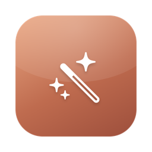
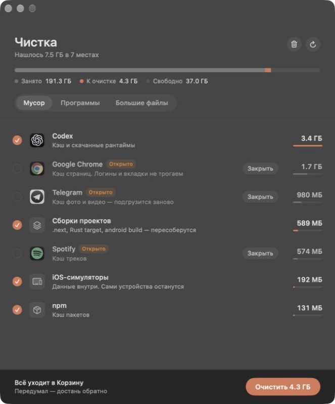
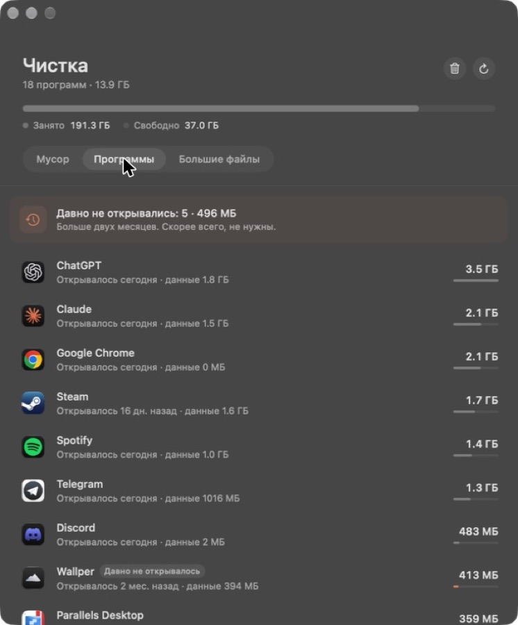

<p align="center"></p>
<h1 align="center">Чистка</h1>

<p align="center">Нативное приложение для macOS (SwiftUI): находит, чем забит диск, и убирает лишнее.</p>

<p align="center">
  
  
</p>

- **Мусор** — кэши Telegram, Chrome, Spotify, Cursor, Codex, Discord, npm/Yarn/pnpm, Homebrew, pip/uv, Gradle, Android-эмуляторы, Xcode DerivedData/DeviceSupport, iOS-симуляторы, сборки в `~/Projects` (`.next`, Rust `target`, android `build`).
- **Программы** — размер вместе с данными в `~/Library` и когда последний раз открывались. Давно не открывавшиеся подсвечены. Удаление забирает и хвосты.
- **Большие файлы** — всё больше 500 МБ в домашней папке, виртуалки Parallels, бэкапы iPhone.

Всё уходит в Корзину — передумал, достань обратно. Насовсем удаляет только кнопка «Очистить Корзину».

## Установка

Скачай `Chistka.zip` из [Releases](../../releases), распакуй, перетащи «Чистка» в «Программы».
Приложение не подписано сертификатом Apple, поэтому при первом запуске: **Системные настройки → Конфиденциальность и безопасность → «Всё равно открыть»**.

macOS 14+, Apple Silicon и Intel.

## Из терминала

`cleanup` — движок, работает и сам по себе:

```bash
./cleanup          # показать, что сколько весит
./cleanup clean    # выбрать номера → в Корзину
```

## Сборка

```bash
./build.sh   # тесты + dist/Чистка.app + dist/Chistka.zip
./test.sh    # только тесты
```

Нужны Xcode Command Line Tools.
